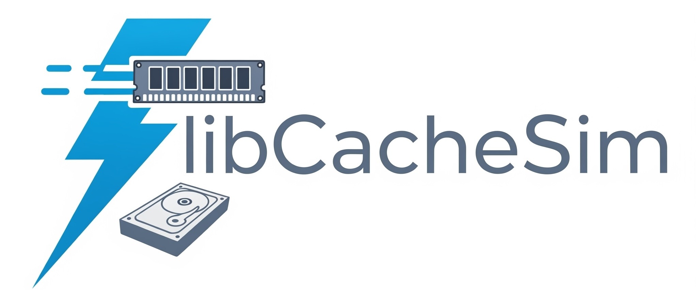

<p align="center">
  <picture>
    
  </picture>
</p>

<h3 align="center">
A high-performance library for building and running cache simulations
</h3>

---

[](https://github.com/1a1a11a/libCacheSim/actions/workflows/build.yml)
[](https://github.com/cacheMon/libCacheSim-python/actions/workflows/pypi-release.yml)
[](https://github.com/1a1a11a/libCacheSim/actions/workflows/npm-release.yml)
[](https://scorecard.dev/viewer/?uri=github.com/1a1a11a/libCacheSim)


## News
* **Nov 2026**: **[PrefixSim](https://github.com/cacheMon/PrefixSim)** brings libCacheSim to LLM serving! Replay real LLM request traces through a KV-block prefix cache and compare 40+ eviction policies by the prefill compute they save, streamed in one pass from the new **[lcp](https://github.com/cacheMon/PrefixSim/blob/main/doc/lcp_format.md)** trace format. Two production traces in lcp are [available on Hugging Face](https://huggingface.co/datasets/harvardMadsys/2026_prefixcache).
* **Aug 2025**: We compiled a list of open-source [cache datasets](https://github.com/cacheMon/cache_dataset).
* **Oct 2024**: **S3-FIFO** gets an upgrade! Please try out the new version (the old one is now named S3-FIFOv0).
* **Oct 2023**: **[S3-FIFO](https://dl.acm.org/doi/10.1145/3600006.3613147)** and **[SIEVE](https://sievecache.com)** are available! These are very simple algorithms that are very effective at reducing cache misses. Try them out in libCacheSim and in your production!
* **Jun 2023**: **QDLP** is available now, see [our paper](https://dl.acm.org/doi/10.1145/3593856.3595887) for details.

---

## What is libCacheSim?

libCacheSim helps you answer questions about caches with real data: how big should my cache be, which eviction algorithm works best for my workload, and what does my workload even look like?

You give it a **trace**, a recorded list of requests from a real system. It replays the trace through simulated caches and reports how often each cache missed. It is fast: it replays more than 20 million requests per second on a realistic trace.

It comes in three parts:

* **`cachesim`**, a command-line cache simulator. No code needed.
* **`traceAnalyzer`**, a command-line tool that describes a trace: request rate, object sizes, popularity, reuse, and more.
* **libCacheSim**, the C library underneath, for building your own simulators such as cache hierarchies or clusters.

There are also [Python](#python) and [Node.js](#nodejs) bindings, and [PrefixSim](https://github.com/cacheMon/PrefixSim) for LLM prefix caches.

### Highlights

* **Fast and lean**: high replay throughput with a small, predictable memory footprint.
* **Lots of algorithms**: dozens of eviction algorithms, plus admission and prefetching policies. See the [full list](#supported-algorithms).
* **Parallel out of the box**: sweep many cache sizes and algorithms at once on all your cores.
* **A real trace analyzer**: every analysis you're likely to need, with plotting scripts.
* **Miss ratio curves at scale**: sampling-based profilers (SHARDS, miniature simulation) build accurate curves for billion-request traces in seconds.
* **Easy to extend**: add an algorithm or a trace format in C/C++, or prototype one in Python with no compilation.

---

## Build and install libCacheSim

On Ubuntu/Debian, install the dependencies, then build:

```bash
sudo apt install build-essential cmake ninja-build libglib2.0-dev libgoogle-perftools-dev libzstd-dev

git clone https://github.com/1a1a11a/libCacheSim
cd libCacheSim
cmake -G Ninja -B _build
ninja -C _build
```

That's it. The tools are now in `_build/bin/`. For macOS, other Linux distributions, the one-line install script, and optional algorithms, see the [install guide](/doc/install.md).

Run your first simulation from the build directory:

```bash
cd _build
./bin/cachesim ../data/cloudPhysicsIO.vscsi vscsi lru 1gb
```

```
../data/cloudPhysicsIO.vscsi LRU cache size     1GiB,           113872 req, miss ratio 0.6297, byte miss ratio 0.7274, throughput 4.62 MQPS
```

A 1 GiB LRU cache misses on 63% of requests for this trace. Now try `s3fifo` instead of `lru`.

> [!NOTE]
> Throughout the docs, commands that start with `./bin/` are run from `_build/`, which is why the sample traces in [data/](/data/) appear as `../data/`.

---

## What do you want to do?

| I want to... | Use | Guide |
| --- | --- | --- |
| Simulate a cache on a trace and compare algorithms | `cachesim` | [cachesim guide](/doc/quickstart_cachesim.md) |
| Understand what a trace looks like | `traceAnalyzer` | [trace analysis](/doc/quickstart_traceAnalyzer.md) |
| Get a miss ratio curve for a huge trace, fast | `mrcProfiler` | [MRC profiling](/doc/quickstart_mrcProfiler.md) |
| Print, convert, sample, or filter a trace | `tracePrint`, `traceConv`, `traceFilter` | [trace utilities](/doc/quickstart_traceUtils.md) |
| Test with a generated uniform or Zipf workload | `cachesim ... syn` | [synthetic traces](/doc/synthetic_traces.md) |
| Try my own eviction algorithm without touching libCacheSim | plugins (C/C++ or Python) | [plugin guide](/doc/quickstart_plugin.md) |
| Build my own simulator in C/C++ | the library | [library guide](/doc/advanced_lib.md), [API reference](/doc/API.md) |
| Add an algorithm or trace format to libCacheSim | the library | [extending libCacheSim](/doc/advanced_lib_extend.md) |
| Simulate an LLM prefix (KV) cache | PrefixSim | [PrefixSim](https://github.com/cacheMon/PrefixSim) |

The [documentation index](/doc/README.md) lists every page, and [DeepWiki](https://deepwiki.com/1a1a11a/libCacheSim) has a generated tour of the code.

---

## A tour of the tools

### cachesim: simulate caches

The arguments are always: trace path, trace type, algorithm(s), cache size(s).

```bash
# several sizes at once (no spaces between them)
./bin/cachesim ../data/cloudPhysicsIO.vscsi vscsi lru 1mb,16mb,256mb,8gb

# sizes as a fraction of the working set (the total size of all distinct objects)
./bin/cachesim ../data/cloudPhysicsIO.vscsi vscsi lru 0.001,0.01,0.1,0.2

# several algorithms x several sizes, all in parallel
./bin/cachesim ../data/cloudPhysicsIO.vscsi vscsi fifo,lru,s3fifo,sieve 0.01,0.1

# count objects instead of bytes: every object has size 1
./bin/cachesim ../data/cloudPhysicsIO.vscsi vscsi lru 1000,16000 --ignore-obj-size 1

# a csv trace: say which column (from 1) holds the time, id, and size
./bin/cachesim ../data/cloudPhysicsIO.csv csv lru 1gb -t "time-col=2, obj-id-col=5, obj-size-col=4, obj-id-is-num=true"
```

For csv traces with numeric ids, add `obj-id-is-num=true`. cachesim stops with an error if you leave it out. The [cachesim guide](/doc/quickstart_cachesim.md) covers trace formats, algorithm parameters, admission and prefetching, and every other option.

### Plot miss ratio curves

The scripts in [scripts/](/scripts/) run `cachesim` for you and plot the results. They expect the build in `_build/`, need the Python packages in [requirements.txt](/requirements.txt) (`pip install -r requirements.txt`), and are run from `scripts/`:

```bash
cd scripts

# miss ratio vs. cache size
python3 plot_mrc_size.py --tracepath ../data/twitter_cluster52.csv --trace-format csv \
    --trace-format-params="time-col=1,obj-id-col=2,obj-size-col=3,obj-id-is-num=1" \
    --algos=fifo,lru,lecar,s3fifo --sizes=0.001,0.002,0.005,0.01,0.02,0.05,0.1,0.2,0.3,0.4

# miss ratio over time
python3 plot_mrc_time.py --tracepath ../data/twitter_cluster52.csv --trace-format csv \
    --trace-format-params="time-col=1,obj-id-col=2,obj-size-col=3,obj-id-is-num=1" \
    --algos=fifo,lru,lecar,s3fifo --report-interval=30 --miss-ratio-type="accu"

# approximate curves with SHARDS or miniature simulation
python3 plot_appr_mrc.py SHARDS ../data/cloudPhysicsIO.vscsi vscsi 0.01
python3 plot_appr_mrc.py MINI ../data/cloudPhysicsIO.vscsi vscsi s3fifo "0.01,0.05,0.1,0.2" 0.1 --extra_args "--ignore-obj-size 1"
```

### traceAnalyzer: understand a trace

```bash
./bin/traceAnalyzer ../data/cloudPhysicsIO.vscsi vscsi --common
```

This prints a summary (request and object counts, compulsory miss ratio, popularity skew, one-hit wonders, and so on) and writes data files you can plot with the scripts in [scripts/traceAnalysis/](/scripts/traceAnalysis/). It is built for traces with billions of requests. See [trace analysis](/doc/quickstart_traceAnalyzer.md).

### mrcProfiler: miss ratio curves for huge traces

Building a fine-grained miss ratio curve by simulating every size is slow on a large trace. `mrcProfiler` samples the trace instead. On a 1.3-billion-request trace, it built an LRU curve 20x faster than simulating every size, with an error under 0.1%:

```bash
./bin/mrcProfiler ../data/cloudPhysicsIO.vscsi vscsi --algo=LRU --profiler=SHARDS \
    --profiler-params=FIX_RATE,0.01,42 --size=100MB,1GB,10
```

See [MRC profiling](/doc/quickstart_mrcProfiler.md).

### Debugging

[scripts/debug.sh](/scripts/debug.sh) builds a debug version and starts `cachesim` under GDB. Run it from the repository root:

```bash
./scripts/debug.sh -- data/cloudPhysicsIO.vscsi vscsi lru,s3fifo 100mb,1gb
```

See the [debugging guide](/doc/debug.md).

---

## Using libCacheSim as a library

The library gives you the same building blocks the tools use: trace readers, caches, and a parallel simulator. Use it to build things the command line can't express, such as a multi-layer cache hierarchy or a cache cluster with consistent hashing.

<details>
<summary>A complete program in 30 lines</summary>

```c
#include <libCacheSim.h>
#include <stdio.h>

int main(void) {
  /* open a trace; see doc/advanced_lib.md for csv and binary traces */
  reader_t *reader = open_trace("../data/cloudPhysicsIO.vscsi", VSCSI_TRACE, NULL);

  /* a reusable container that each read fills in */
  request_t *req = new_request();

  /* a 1 MiB LRU cache */
  common_cache_params_t cc_params = default_common_cache_params();
  cc_params.cache_size = 1 * MiB;
  cache_t *cache = LRU_init(cc_params, NULL);

  /* replay the trace; get() returns true on a hit */
  uint64_t n_req = 0, n_miss = 0;
  while (read_one_req(reader, req) == 0) {
    if (!cache->get(cache, req)) {
      n_miss++;
    }
    n_req++;
  }

  printf("miss ratio: %.4lf\n", (double)n_miss / n_req);

  close_trace(reader);
  free_request(req);
  cache->cache_free(cache);
  return 0;
}
```

Install the library first (`sudo ninja -C _build install` from the repository root, see the [install guide](/doc/install.md#3-install-the-library-optional)), save this as `test.c`, and compile:

```bash
gcc test.c $(pkg-config --cflags --libs libCacheSim glib-2.0) -o test.out -lm -lzstd
```

The trace path is relative, so run it from a directory next to `data/`, such as `_build/`:

```bash
./test.out
```

It prints `miss ratio: 0.8646`.

</details>

Next, read the [library guide](/doc/advanced_lib.md) and browse the [examples](/example/): a basic simulator, a parallel simulator, a cache hierarchy, and a cache cluster.

To add a new eviction algorithm or trace format to libCacheSim itself, see [extending libCacheSim](/doc/advanced_lib_extend.md).

---

## Python

If you don't need every last bit of speed, the Python binding is the easiest way in:

```shell
pip install libcachesim
```

```python
from libcachesim import SyntheticReader, TraceReader, FIFO

reader = SyntheticReader(num_objects=1000, num_of_req=10000, alpha=1.0, dist="zipf")  # synthetic trace
# reader = TraceReader("./data/cloudPhysicsIO.oracleGeneral.bin")                    # real trace
cache = FIFO(cache_size=1024*1024)
obj_miss_ratio, byte_miss_ratio = cache.process_trace(reader)
print(f"Obj miss ratio: {obj_miss_ratio:.4f}, byte miss ratio: {byte_miss_ratio:.4f}")
```

You can also write a new eviction algorithm in pure Python, with **no C/C++ compilation**.

<details>
<summary>An LRU written in Python</summary>

You supply a handful of hooks. libCacheSim calls them on hits, misses, and evictions, and does the bookkeeping.

```python
from collections import OrderedDict
from typing import Any

from libcachesim import PluginCache, SyntheticReader, LRU, CommonCacheParams, Request

def init_hook(_: CommonCacheParams) -> Any:
    return OrderedDict()

def hit_hook(data: Any, req: Request) -> None:
    data.move_to_end(req.obj_id, last=True)

def miss_hook(data: Any, req: Request) -> None:
    data.__setitem__(req.obj_id, req.obj_size)

def eviction_hook(data: Any, _: Request) -> int:
    return data.popitem(last=False)[0]

def remove_hook(data: Any, obj_id: int) -> None:
    data.pop(obj_id, None)

def free_hook(data: Any) -> None:
    data.clear()


plugin_lru_cache = PluginCache(
    cache_size=128,
    cache_init_hook=init_hook,
    cache_hit_hook=hit_hook,
    cache_miss_hook=miss_hook,
    cache_eviction_hook=eviction_hook,
    cache_remove_hook=remove_hook,
    cache_free_hook=free_hook,
    cache_name="Plugin_LRU",
)

reader = SyntheticReader(num_objects=1000, num_of_req=10000, obj_size=1, alpha=1.0, dist="zipf")
req_miss_ratio, byte_miss_ratio = plugin_lru_cache.process_trace(reader)
ref_req_miss_ratio, ref_byte_miss_ratio = LRU(128).process_trace(reader)
print(f"plugin req miss ratio {req_miss_ratio}, ref req miss ratio {ref_req_miss_ratio}")
print(f"plugin byte miss ratio {byte_miss_ratio}, ref byte miss ratio {ref_byte_miss_ratio}")
```

The two miss ratios should match.

</details>

See the [libCacheSim-python README](https://github.com/cacheMon/libCacheSim-python) for more, and the [plugin guide](/doc/quickstart_plugin.md) for writing plugins in C/C++.

## Node.js

Node.js bindings are available for Linux x64. The package ships a pre-compiled binary. If it doesn't load, `npm install` compiles the addon from source, which needs the [build dependencies](/doc/install.md).

```shell
npm install libcachesim-node
```

```javascript
const { runSimulation } = require('libcachesim-node');

const result = runSimulation('/path/to/trace.vscsi', 'vscsi', 's3fifo', '1mb');
```

See [libCacheSim-node](/libCacheSim-node/) for the full API and the bundled `cachesim-js` CLI.

---

## Supported algorithms

The name in `code` is what you pass to `cachesim` (names are case-insensitive).

### Eviction algorithms
* [FIFO](/libCacheSim/cache/eviction/FIFO.c) `fifo`, [LRU](/libCacheSim/cache/eviction/LRU.c) `lru`, [MRU](/libCacheSim/cache/eviction/MRU.c) `mru`, [Clock](/libCacheSim/cache/eviction/Clock.c) `clock`, [SLRU](/libCacheSim/cache/eviction/SLRU.c) `slru`, [Random](/libCacheSim/cache/eviction/Random.c) `random`, [RandomTwo](/libCacheSim/cache/eviction/RandomTwo.c) `randomtwo`
* [LFU](/libCacheSim/cache/eviction/LFU.c) `lfu`, [LFU with dynamic aging](/libCacheSim/cache/eviction/LFUDA.c) `lfuda`
* [ARC](/libCacheSim/cache/eviction/ARC.c) `arc`, [TwoQ](/libCacheSim/cache/eviction/TwoQ.c) `2q`, [MQ](/libCacheSim/cache/eviction/MQ.c) `mq`, [CLOCK-PRO](/libCacheSim/cache/eviction/ClockPro.c) `clockpro`, [CAR](/libCacheSim/cache/eviction/CAR.c) `car`, [LIRS](/libCacheSim/cache/eviction/LIRS.c) `lirs`, [Clock2QPlus](/libCacheSim/cache/eviction/Clock2QPlus.c) `clock2qplus`
* [LRU-K](/libCacheSim/cache/eviction/cpp/LRU_K.cpp) `lru-k`, [LRU-Prob](/libCacheSim/cache/eviction/LRUProb.c) `lru-prob`, [Size](/libCacheSim/cache/eviction/Size.c) `size`
* [FIFO-Merge](/libCacheSim/cache/eviction/FIFO_Merge.c) `fifo-merge`
* [Belady](/libCacheSim/cache/eviction/Belady.c) `belady`, [BeladySize](/libCacheSim/cache/eviction/BeladySize.c) `beladysize`, [BeladyCompute](/libCacheSim/cache/eviction/BeladyCompute.c) `beladyCompute` — these need future information, so they only work on oracle traces such as `oracleGeneral`
* [GDSF](/libCacheSim/cache/eviction/cpp/GDSF.cpp) `gdsf`
* [Hyperbolic](/libCacheSim/cache/eviction/Hyperbolic.c) `hyperbolic`
* [LeCaR](/libCacheSim/cache/eviction/LeCaR.c) `lecar`
* [Cacheus](/libCacheSim/cache/eviction/Cacheus.c) `cacheus`
* [LHD](/libCacheSim/cache/eviction/LHD/LHD_Interface.cpp) `lhd`
* [LRB](/libCacheSim/cache/eviction/LRB/LRB_Interface.cpp) `lrb` — build with `-DENABLE_LRB=ON`
* [GLCache](/libCacheSim/cache/eviction/GLCache/GLCache.c) `glcache` — build with `-DENABLE_GLCACHE=ON`
* [3LCache](/libCacheSim/cache/eviction/3LCache/) `3lcache` — build with `-DENABLE_3L_CACHE=ON`
* [WTinyLFU](/libCacheSim/cache/eviction/WTinyLFU.c) `wtinylfu`
* [QD-LP](/libCacheSim/cache/eviction/QDLP.c) `qdlp`
* [S3-FIFO](/libCacheSim/cache/eviction/S3FIFO.c) `s3fifo`
* [S4-FIFO](/libCacheSim/cache/eviction/S4FIFO/S4FIFO.c) `s4fifo` — build with `-DENABLE_S4FIFO=ON`
* [Sieve](/libCacheSim/cache/eviction/Sieve.c) `sieve`
* [Merlin](/libCacheSim/cache/eviction/cpp/merlin.cpp) `merlin`

The eviction policies for LLM prefix caches are listed in [PrefixSim](https://github.com/cacheMon/PrefixSim#eviction-policies), which runs them.

### Admission algorithms
Pass with `-a`, e.g. `-a bloomFilter`.
* [AdaptSize](/libCacheSim/cache/admission/adaptsize/) `adaptSize`
* [Bloom filter](/libCacheSim/cache/admission/bloomfilter.c) `bloomFilter`
* [Probabilistic](/libCacheSim/cache/admission/prob.c) `prob`
* [Size](/libCacheSim/cache/admission/size.c) `size`
* [SizeProbabilistic](/libCacheSim/cache/admission/sizeProbabilistic.c) `sizeProbabilistic`

### Prefetching algorithms
Pass with `-p`, e.g. `-p Mithril`.
* [OBL](/libCacheSim/cache/prefetch/OBL.c) `OBL`
* [Mithril](/libCacheSim/cache/prefetch/Mithril.c) `Mithril`
* [PG](/libCacheSim/cache/prefetch/PG.c) `PG`

---

## Traces

libCacheSim reads csv, txt, and binary traces, plus several specific formats (`vscsi`, `twr`, `oracleGeneral`, `lcs`, `lcp`). Binary traces are faster to replay and smaller on disk, and zstd-compressed traces are read directly, without decompressing first. Use [traceConv](/doc/quickstart_traceUtils.md) to convert a trace to a binary format.

The [data/](/data/) directory has small sample traces in several formats (`csv`, `txt`, `vscsi`, `lcs`, and `oracleGeneral`). They are **very small** and **should not be used to compare algorithms' miss ratios**.

For real experiments, we maintain a list of open-source cache datasets at [cacheMon/cache_dataset](https://github.com/cacheMon/cache_dataset). Many are available in the `oracleGeneral` format: zstd-compressed records of

```c
struct {
    uint32_t clock_time;
    uint64_t obj_id;
    uint32_t obj_size;
    int64_t next_access_vtime;  // -1 if no next access
}
```

To look inside one, use `./bin/tracePrint <trace> oracleGeneral`.

---

## Contributing

We gladly welcome pull requests. [CONTRIBUTING.md](/CONTRIBUTING.md) covers building, testing, and submitting changes, and [extending libCacheSim](/doc/advanced_lib_extend.md) covers adding a new algorithm or trace reader.

For large changes, please open an issue first so we can discuss the approach. Small fixes can go straight to a pull request. The project follows Google's coding style, and participants are expected to follow our [Code of Conduct](/CODE_OF_CONDUCT.md).

Found a security issue? Please report it privately, see [SECURITY.md](/SECURITY.md).

Questions? Check the [FAQ](/FAQ.md) or ask in [Discussions](https://github.com/1a1a11a/libCacheSim/discussions).

---

## Citing libCacheSim

If you use libCacheSim in your research, please cite these papers.

<details>
<summary>BibTeX</summary>

```
@inproceedings{yang2020-workload,
    author = {Juncheng Yang and Yao Yue and K. V. Rashmi},
    title = {A large-scale analysis of hundreds of in-memory cache clusters at Twitter},
    booktitle = {14th USENIX Symposium on Operating Systems Design and Implementation (OSDI 20)},
    year = {2020},
    isbn = {978-1-939133-19-9},
    pages = {191--208},
    url = {https://www.usenix.org/conference/osdi20/presentation/yang},
    publisher = {USENIX Association},
}

@inproceedings{yang2023-s3fifo,
  title = {FIFO Queues Are All You Need for Cache Eviction},
  author = {Juncheng Yang and Yazhuo Zhang and Ziyue Qiu and Yao Yue and K.V. Rashmi},
  isbn = {9798400702297},
  publisher = {Association for Computing Machinery},
  booktitle = {Symposium on Operating Systems Principles (SOSP'23)},
  pages = {130–149},
  numpages = {20},
  year={2023}
}

@inproceedings{yang2023-qdlp,
  author = {Juncheng Yang and Ziyue Qiu and Yazhuo Zhang and Yao Yue and K.V. Rashmi},
  title = {FIFO Can Be Better than LRU: The Power of Lazy Promotion and Quick Demotion},
  year = {2023},
  isbn = {9798400701955},
  publisher = {Association for Computing Machinery},
  doi = {10.1145/3593856.3595887},
  booktitle = {Proceedings of the 19th Workshop on Hot Topics in Operating Systems (HotOS23)},
  pages = {70–79},
  numpages = {10},
}
```

</details>

GitHub's **Cite this repository** button uses [CITATION.cff](/CITATION.cff). [references.md](/references.md) has the same entries as BibTeX, plus the SIEVE paper.

**Who uses libCacheSim?** [doc/adoption.md](/doc/adoption.md) keeps a source-linked list of third-party papers, forks, and projects built on it.

---

## License
libCacheSim is licensed under the [Apache License 2.0](LICENSE).

## Related
* [PyMimircache](https://github.com/1a1a11a/PyMimircache): a Python-based cache trace analysis platform, now deprecated.
