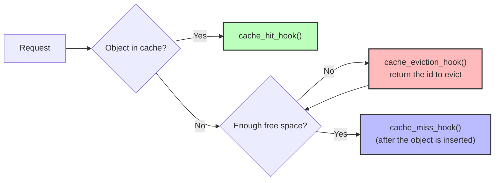

# Writing an eviction algorithm as a plugin

A plugin lets you try a new eviction algorithm without touching or rebuilding libCacheSim. You write a handful of small functions ("hooks") in Python, C, or C++. libCacheSim calls them on every hit, miss, and eviction.

* **Python plugins** need no compiling at all. They are the fastest way to prototype or teach.
* **C/C++ plugins** are built into a shared library (`.so` or `.dylib`) that `cachesim` loads at run time. They are much faster than Python and can be shipped separately from libCacheSim.

When an algorithm is ready to become part of libCacheSim, see [Adding algorithms and trace readers](advanced_lib_extend.md).

---

## How plugins work

libCacheSim keeps its own record of which objects are in the cache and how much space they use. Your plugin decides only **which object to evict**, and keeps whatever state it needs to make that choice.

For every request, libCacheSim checks whether the object is cached and then calls your hooks:



Note the order on a miss. libCacheSim first calls `cache_eviction_hook()` as many times as it needs to free space. Then it inserts the new object, and only *then* calls `cache_miss_hook()`. So while your eviction hook is choosing a victim, the new object is not yet in your plugin's data structure.

The hooks are the same in every language:

| Hook | Called when | What to do |
| --- | --- | --- |
| `cache_init_hook(params)` | once, when the cache is created | create your state and return it. libCacheSim passes it back to every other hook as `data`. |
| `cache_hit_hook(data, req)` | the requested object is in the cache | update your state, e.g. move the object to the front of a list |
| `cache_miss_hook(data, req)` | the object was not cached and has just been inserted | start tracking the object |
| `cache_eviction_hook(data, req)` | the cache needs space | return the id of an object **that is in the cache**; libCacheSim evicts it |
| `cache_remove_hook(data, obj_id)` | an object is removed explicitly, not by eviction | stop tracking it |
| `cache_free_hook(data)` | the cache is destroyed | release your state (optional, but recommended) |

`req` gives you the request's `obj_id`, `obj_size`, and other fields.

One thing to watch: objects larger than the whole cache are never inserted, but `cache_miss_hook()` is still called for them. Check `req->obj_size <= cache_size` before you add an object to your own structure, or your eviction hook may later return an object libCacheSim never stored.

---

## Python plugins

### 1. Install the Python binding

```bash
pip3 install libcachesim
```

### 2. Write the hooks

Here is FIFO as a plugin. Save it as `plugins/plugin_fifo.py`, in a new `plugins/` folder at the root of your libCacheSim checkout:

```python
from collections import deque
from libcachesim import CommonCacheParams, Request


class FifoCache:
    def __init__(self, cache_size: int):
        self.queue = deque()
        self.cache_size = cache_size

    def on_hit(self, req: Request):
        pass  # FIFO doesn't reorder on a hit

    def on_miss(self, req: Request):
        if req.obj_size <= self.cache_size:
            self.queue.append(req.obj_id)

    def evict(self, req: Request):
        if not self.queue:
            return 0
        return self.queue.popleft()

    def on_remove(self, obj_id: int):
        try:
            self.queue.remove(obj_id)
        except ValueError:
            pass  # not tracked


def cache_init_hook(common_cache_params: CommonCacheParams):
    return FifoCache(common_cache_params.cache_size)


def cache_hit_hook(data: FifoCache, req: Request):
    data.on_hit(req)


def cache_miss_hook(data: FifoCache, req: Request):
    data.on_miss(req)


def cache_eviction_hook(data: FifoCache, req: Request):
    return data.evict(req)


def cache_remove_hook(data: FifoCache, obj_id: int):
    data.on_remove(obj_id)


def cache_free_hook(data: FifoCache):
    data.queue.clear()
```

Your state can be any Python object: a class like this, a `dict`, an `OrderedDict`, and so on.

### 3. Run it

There is no build step. Hand the hooks to `PluginCache` and replay a trace. Add this to the bottom of the same file:

```python
if __name__ == "__main__":
    from pathlib import Path
    from libcachesim import PluginCache, TraceReader, TraceType

    cache = PluginCache(
        cache_size=1024 * 1024,  # 1 MiB
        cache_init_hook=cache_init_hook,
        cache_hit_hook=cache_hit_hook,
        cache_miss_hook=cache_miss_hook,
        cache_eviction_hook=cache_eviction_hook,
        cache_remove_hook=cache_remove_hook,
        cache_free_hook=cache_free_hook,
        cache_name="fifo",
    )

    trace = Path(__file__).parent.parent / "data" / "cloudPhysicsIO.vscsi"
    reader = TraceReader(trace=str(trace), trace_type=TraceType.VSCSI_TRACE)

    req_miss_ratio, byte_miss_ratio = cache.process_trace(reader)
    print(f"Request miss ratio: {req_miss_ratio:.4f}")
    print(f"Byte miss ratio: {byte_miss_ratio:.4f}")
```

```bash
python3 plugins/plugin_fifo.py
```

The request miss ratio should be `0.8766`, the same as the built-in FIFO at 1 MiB. Comparing against the built-in version of an algorithm is a quick way to check a plugin.

---

## C/C++ plugins

> [!IMPORTANT]
> Build libCacheSim first, following [Build and install libCacheSim](/README.md#build-and-install-libcachesim). The commands below assume the build directory is `_build/` at the root of your checkout.

### 1. Write the hooks

In C or C++, the hooks are plain C functions with these exact names. libCacheSim looks them up by name with `dlsym()`:

```c
void *cache_init_hook(const common_cache_params_t ccache_params);
void cache_hit_hook(void *data, const request_t *req);
void cache_miss_hook(void *data, const request_t *req);
obj_id_t cache_eviction_hook(void *data, const request_t *req);
void cache_remove_hook(void *data, obj_id_t obj_id);
void cache_free_hook(void *data);  /* optional */
```

Here is FIFO in C++. Create a `plugins/` folder at the root of your checkout and save this as `plugins/plugin_fifo.cpp`:

```cpp
#include <libCacheSim.h>

#include <deque>

class FifoCache {
 private:
  std::deque<obj_id_t> queue_;
  uint64_t cache_size_;

 public:
  FifoCache(uint64_t cache_size) : cache_size_(cache_size) {}

  void on_hit(obj_id_t id) {}

  void on_miss(obj_id_t id, uint64_t size) {
    if (size <= cache_size_) {
      queue_.push_back(id);
    }
  }

  obj_id_t evict() {
    if (queue_.empty()) {
      return 0;
    }
    obj_id_t victim = queue_.front();
    queue_.pop_front();
    return victim;
  }

  void on_remove(obj_id_t id) {
    for (auto it = queue_.begin(); it != queue_.end(); ++it) {
      if (*it == id) {
        queue_.erase(it);
        break;
      }
    }
  }
};

extern "C" {
void *cache_init_hook(const common_cache_params_t params) {
  return new FifoCache(params.cache_size);
}

void cache_hit_hook(void *data, const request_t *req) {
  static_cast<FifoCache *>(data)->on_hit(req->obj_id);
}

void cache_miss_hook(void *data, const request_t *req) {
  static_cast<FifoCache *>(data)->on_miss(req->obj_id, req->obj_size);
}

obj_id_t cache_eviction_hook(void *data, const request_t * /*req*/) {
  return static_cast<FifoCache *>(data)->evict();
}

void cache_remove_hook(void *data, obj_id_t obj_id) {
  static_cast<FifoCache *>(data)->on_remove(obj_id);
}

void cache_free_hook(void *data) {
  FifoCache *fifo_cache = (FifoCache *)data;
  delete fifo_cache;
}
}  // extern "C"
```

The `extern "C"` block matters. Without it, C++ mangles the function names and libCacheSim can't find them. Your plugin can allocate whatever it likes; the memory lives until `cache_free_hook()` runs. Keep all state in the object you return from `cache_init_hook()` rather than in global variables. `cachesim` gives each cache its own state, but it may simulate several caches in parallel threads.

### 2. Build it

Any build system that produces a shared library will do. With CMake, save this as `plugins/CMakeLists.txt`:

```cmake
cmake_minimum_required(VERSION 3.12)
project(plugins CXX C)

find_package(PkgConfig REQUIRED)
pkg_check_modules(GLIB REQUIRED glib-2.0)

set(PLUGINS fifo)  # Add more plugins here when you create them

foreach(plugin IN LISTS PLUGINS)
  add_library(plugin_${plugin} SHARED plugin_${plugin}.cpp)

  target_include_directories(plugin_${plugin} PRIVATE
    ${CMAKE_CURRENT_SOURCE_DIR}/../libCacheSim/include
    ${GLIB_INCLUDE_DIRS})

  set_target_properties(plugin_${plugin} PROPERTIES
    OUTPUT_NAME "plugin_${plugin}_hooks")
endforeach()
```

Then, from the `plugins/` folder:

```bash
mkdir -p build && cd build/
cmake -G Ninja .. && ninja
```

This produces `libplugin_fifo_hooks.so` in `plugins/build/` (`libplugin_fifo_hooks.dylib` on macOS).

### 3. Run it with `cachesim`

Use the algorithm name `pluginCache` and pass the library's path with `-e`. From `plugins/build/`:

```bash
../../_build/bin/cachesim ../../data/cloudPhysicsIO.vscsi vscsi pluginCache 1MB \
  -e "plugin_path=./libplugin_fifo_hooks.so"
```

Keep the `./`, or use an absolute path. A bare file name like `libplugin_fifo_hooks.so` makes `dlopen()` search the system library path instead of the current folder, and loading fails with `cannot open shared object file`.

You should get a miss ratio of `0.8766`, the same as `cachesim ... fifo 1MB`.

The `-e` string takes comma-separated keys:

| Key | Meaning |
| --- | --- |
| `plugin_path` | **Required.** Path to the `.so` or `.dylib`. |
| `cache_name` | Display name in the output. Defaults to `pluginCache-<file name>`. |
| `print` | Print the current parameters and exit. |

For example, `-e "plugin_path=./libplugin_fifo_hooks.so,cache_name=myFIFO"` labels the results `myFIFO`.

---

## More examples

* C/C++: [example/plugin_v2/](/example/plugin_v2/) has an LRU plugin and a test program that loads it.
* Python: the [libCacheSim-python examples](https://github.com/cacheMon/libCacheSim-python/tree/main/examples).

---

## Troubleshooting

**`Failed to load plugin ...: cannot open shared object file`**: the path is wrong, or it is a bare file name. Use `./libplugin_..._hooks.so` or an absolute path.

**The plugin loads but crashes right away**: a hook is missing or misspelled. Every hook except `cache_free_hook` is required. The names must match the table above exactly, and in C++ they must be inside `extern "C"`.

**`pluginCache: object ... to be evicted not found in cache`**: your eviction hook returned an id libCacheSim isn't storing. The usual causes are tracking an object that was too large to insert, returning `0` from an empty structure, or forgetting to stop tracking an object in `cache_remove_hook`.

**Link errors**: build the plugin with the same architecture flags (such as `-m64`) as libCacheSim.

**Crash inside a hook**: run under gdb and set breakpoints on your hooks, e.g. `gdb -ex r --args ../../_build/bin/cachesim ...`. See the [debugging guide](debug.md).

**A Python plugin is slow**: use `process_trace()` instead of calling `get()` per request in Python. Expect it to be far slower than a C/C++ plugin either way.

**A re-implemented algorithm doesn't match the built-in one**: plugins see a simpler interface than built-in algorithms. In particular, there is no `find` hook, so work that a built-in algorithm does during lookup has to happen in your hit, miss, or eviction hook instead. Compare against the built-in version on a sample trace to find where they diverge.
