# Analyze a trace with traceAnalyzer

`traceAnalyzer` tells you what a workload looks like before you simulate it: how many requests and objects it has, how big the objects are, how often they come back, and how popular the hottest ones are. It is fast enough for traces with billions of requests. It also writes data files that the plotting scripts in [scripts/traceAnalysis/](/scripts/traceAnalysis/) turn into figures.

All commands on this page run from the build directory, `_build/`. If you built with `cmake -G Ninja -B _build && ninja -C _build` from the repository root, the sample traces are at `../data/`. The plotting scripts also run from `_build/`, as `python3 ../scripts/traceAnalysis/<script>.py`.

The source lives in [libCacheSim/bin/traceAnalyzer/](/libCacheSim/bin/traceAnalyzer) (command line) and [libCacheSim/traceAnalyzer/](/libCacheSim/traceAnalyzer) (the analyses).

## Quick start

```bash
./bin/traceAnalyzer ../data/cloudPhysicsIO.vscsi vscsi --common
```

You get a summary of the trace on screen (trimmed here):

```text
dat: ../data/cloudPhysicsIO.vscsi
number of requests: 113872, number of objects: 48974
number of req GiB: 3.9171, number of obj GiB: 1.8904
compulsory miss ratio (req/byte): 0.4301/0.4826
object size weighted by req/obj: 36936/41445
frequency mean: 2.3252
time span: 7200(0.0833 day)
request rate min 3.0433 req/s, max 117.5267 req/s, window 300s
object rate min 1.1467 obj/s, max 81.2400 obj/s, window 300s
popularity: Zipf alpha=0.5464, R2=0.8743
X-hit (number of obj accessed X times): 21049(0.4298), 18839(0.3847), 827(0.0169), 6059(0.1237), ...
freq (fraction) of the most popular obj: 1630(0.0143), 1342(0.0118), 1341(0.0118), 652(0.0057), ...
```

A few lines worth knowing:

* **compulsory miss ratio** is the miss ratio of an infinitely large cache. Every object misses the first time it is seen, so no algorithm can do better than this.
* **X-hit** counts objects requested exactly 1, 2, 3, ... times. The first number is the *one-hit wonders*, objects requested only once. Here 43% of objects are never reused.
* **popularity** fits a Zipf distribution to the request counts. A larger `alpha` means a more skewed workload, where a few objects get most of the requests.

The same summary is appended to the files `stat` and `traceStat` in the current directory.

## Pick what to analyze

The basic form is:

```bash
./bin/traceAnalyzer <trace_path> <trace_type> [--task1] [--task2] ...
```

| Task | What it produces | Plot it with |
| --- | --- | --- |
| `--common` | The summary above, plus `--reqRate`, `--accessPattern`, `--size`, `--reuse` and `--popularity` | the scripts below |
| `--all` | Everything in `--common`, plus popularity decay | the scripts below |
| `--reqRate` | Requests, bytes and distinct objects per time window | [req_rate.py](/scripts/traceAnalysis/req_rate.py) |
| `--size` | Object size distribution, overall and over time | [size.py](/scripts/traceAnalysis/size.py), [size_heatmap.py](/scripts/traceAnalysis/size_heatmap.py) |
| `--reuse` | Reuse time and reuse distance distribution, overall and over time | [reuse.py](/scripts/traceAnalysis/reuse.py), [reuse_heatmap.py](/scripts/traceAnalysis/reuse_heatmap.py) |
| `--popularity` | Request count of each object, by rank | [popularity.py](/scripts/traceAnalysis/popularity.py) |
| `--accessPattern` | A sample of which objects are accessed when | [access_pattern.py](/scripts/traceAnalysis/access_pattern.py) |
| `--popularityDecay` | How an object's popularity fades with age | [popularity_decay.py](/scripts/traceAnalysis/popularity_decay.py) |

Run `./bin/traceAnalyzer --help` for the full list of tasks and options.

### Where the data files go

Each analysis writes a data file named after the trace into the current directory. After `--common` on the sample trace you will have:

```text
cloudPhysicsIO.vscsi.accessRtime          cloudPhysicsIO.vscsi.reuse
cloudPhysicsIO.vscsi.accessVtime          cloudPhysicsIO.vscsi.reuseWindow_w300_rt
cloudPhysicsIO.vscsi.popularity           cloudPhysicsIO.vscsi.reuseWindow_w300_vt
cloudPhysicsIO.vscsi.reqRate_w300         cloudPhysicsIO.vscsi.sizeWindow_w300_obj
cloudPhysicsIO.vscsi.size                 cloudPhysicsIO.vscsi.sizeWindow_w300_req
```

`w300` is the time window in seconds (`--time-window`, default 300). Use `-o <prefix>` to choose a different file name prefix.

### Two more example summaries

<details>
<summary>A block cache workload (w92), one week long</summary>

```text
dat: w92.oracleGeneral.bin.zst
number of requests: 4284658, number of objects: 606386
number of req GiB: 133.5165, number of obj GiB: 21.7219
compulsory miss ratio (req/byte): 0.1415/0.1627
object size weighted by req/obj: 33459/38463
frequency mean: 7.0659
time span: 609774(7.0576 day)
request rate min 0.5400 req/s, max 257.7533 req/s, window 300s
object rate min 0.1333 obj/s, max 256.6933 obj/s, window 300s
X-hit (number of obj accessed X times): 5720(0.0094), 4813(0.0079), 4514(0.0074), 5044(0.0083), 34919(0.0576), 529106(0.8726), 2551(0.0042), 2161(0.0036),
freq (fraction) of the most popular obj: 74030(0.0173), 74007(0.0173), 59484(0.0139), 39656(0.0093), 27403(0.0064), 27391(0.0064), 21380(0.0050), 19828(0.0046),
```

</details>

<details>
<summary>The first 10 million requests of the Twitter cluster52 trace (in the data directory)</summary>

```text
dat: ../data/twitter_cluster52_10m.csv
number of requests: 10000000, number of objects: 897664
number of req GiB: 1.8806, number of obj GiB: 0.1627
compulsory miss ratio (req/byte): 0.0898/0.0865
object size weighted by req/obj: 201/194
frequency mean: 11.1400
time span: 5293(0.0613 day)
write: 0(0), overwrite: 0(0), del:0(0)
request rate min 1753.7533 req/s, max 1986.3433 req/s, window 300s
object rate min 300.3567 obj/s, max 319.8633 obj/s, window 300s
popularity: Zipf alpha=0.9472, R2=0.97
X-hit (number of obj accessed X times): 323699(0.3606), 218436(0.2433), 51516(0.0574), 128181(0.1428), 48785(0.0543), 25172(0.0280), 14606(0.0163), 14769(0.0165),
freq (fraction) of the most popular obj: 546563(0.0547), 365140(0.0365), 221311(0.0221), 190811(0.0191), 154037(0.0154), 151832(0.0152), 127070(0.0127), 98851(0.0099),
```

</details>

## Plot the results

The plotting scripts need the Python packages in [requirements.txt](/requirements.txt). Install them once from the repository root:

```bash
pip install -r requirements.txt
```

Then, from `_build/`, pass each script the data file traceAnalyzer wrote. In the commands below, `${dataname}` is the trace file name, for example `cloudPhysicsIO.vscsi`. Figures are saved to a `figure/` directory under the current directory.

The example plots come from two workloads: **w92**, a week-long block cache trace, and the first 10 million requests of **Twitter cluster52**, an in-memory key-value cache trace.

### Access pattern

This shows which objects are accessed over time, using a sample of objects. It makes patterns such as scans and daily cycles easy to see. There are two versions: one against wall-clock time, and one against *virtual time*, which is the request count.

```bash
python3 ../scripts/traceAnalysis/access_pattern.py ${dataname}.accessRtime
python3 ../scripts/traceAnalysis/access_pattern.py ${dataname}.accessVtime
```

<p align="center">


</p>
<p align="center"><i>w92. Left: wall-clock time. Right: virtual time. This workload is driven mostly by a daily scan.</i></p>

<p align="center">
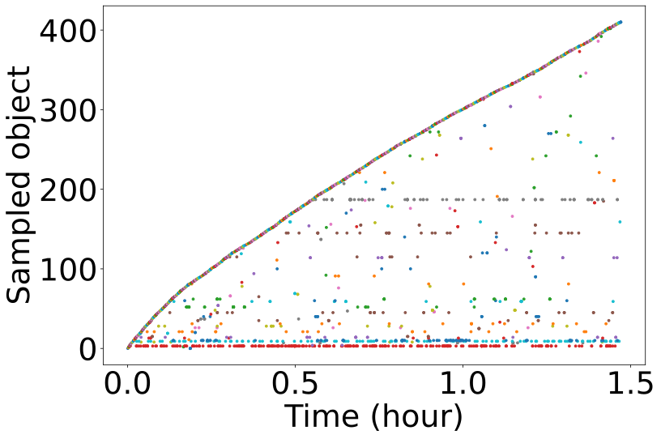

</p>
<p align="center"><i>Twitter cluster52, first 10M requests. This is a Zipf-like workload.</i></p>

The access pattern analysis is expensive on large traces. If it is slow or the plot is too crowded, tune `--access-pattern-sample-ratio` (default 0.01).

### Request rate

This needs a trace with timestamps.

```bash
python3 ../scripts/traceAnalysis/req_rate.py ${dataname}.reqRate_w300
```

<p align="center">
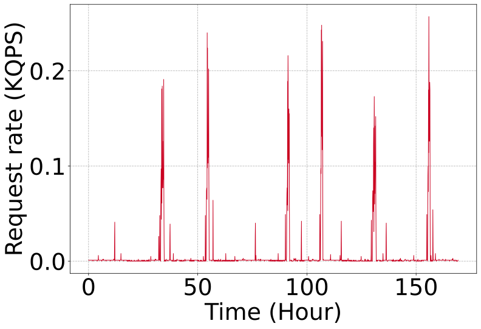
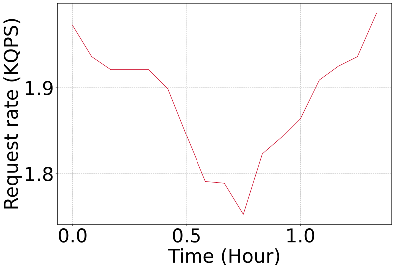
</p>
<p align="center"><i>Left: w92, which has a daily spike. Right: Twitter cluster52, too short to show a daily pattern.</i></p>

### Object size distribution

This needs a trace with object sizes.

```bash
python3 ../scripts/traceAnalysis/size.py ${dataname}.size
```

<p align="center">
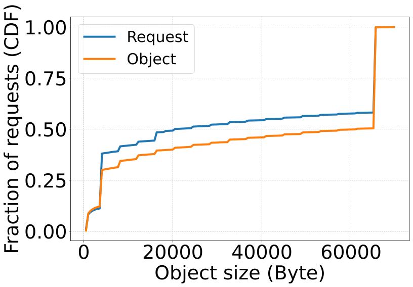
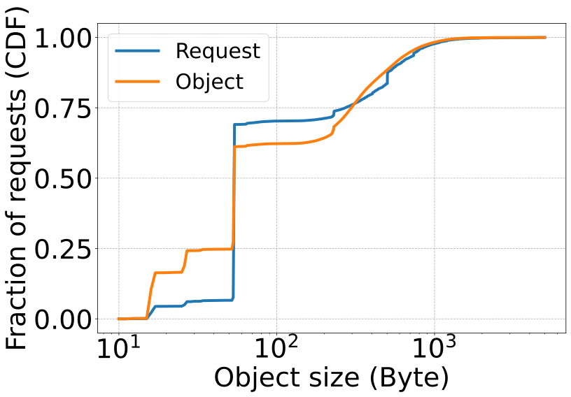
</p>
<p align="center"><i>Left: w92, where most objects are 4 KiB or 64 KiB. Right: Twitter cluster52, where most objects are about 64 bytes.<br>The "Request" curve counts each request; the "Object" curve counts each object once.</i></p>

### Reuse distribution

*Reuse time* is how long since an object was last requested. Measured in requests instead of seconds, it is called *reuse distance*. Short reuse times mean even a small cache can catch them.

```bash
python3 ../scripts/traceAnalysis/reuse.py ${dataname}.reuse
```

<p align="center">
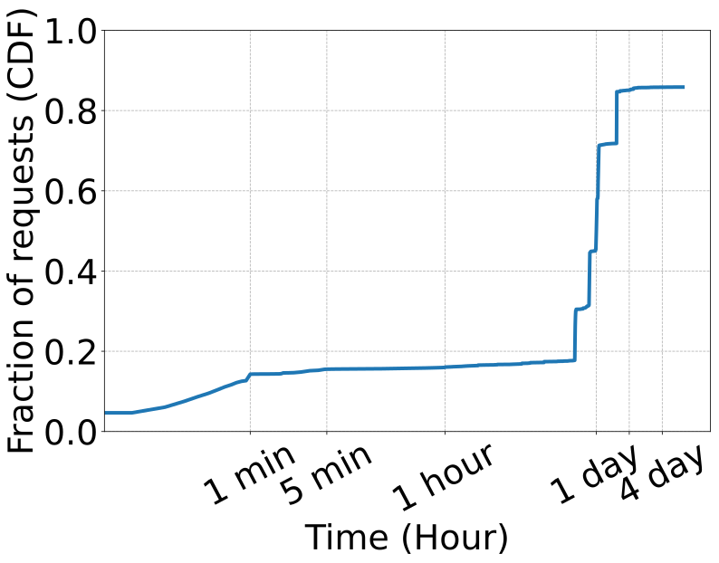
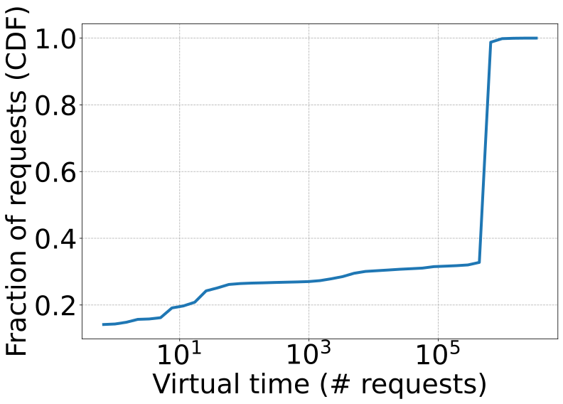
</p>
<p align="center"><i>w92. Left: reuse time. Right: reuse distance. Most reuses happen about a day later.</i></p>

<p align="center">
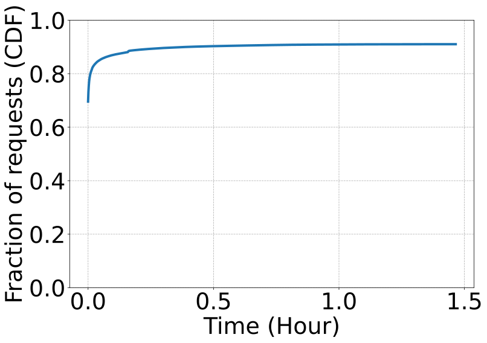
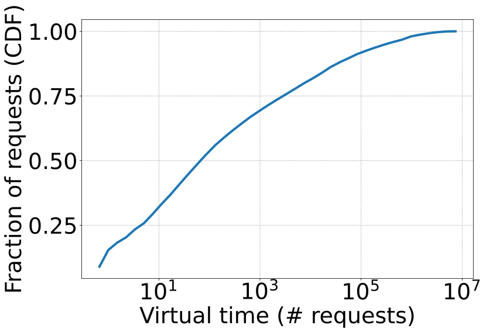
</p>
<p align="center"><i>Twitter cluster52. Most objects are requested again soon after the last access.</i></p>

### Popularity

This plots each object's request count against its popularity rank. The skewness (Zipf `alpha`) is already printed in traceAnalyzer's summary.

```bash
python3 ../scripts/traceAnalysis/popularity.py ${dataname}.popularity
```

<p align="center">
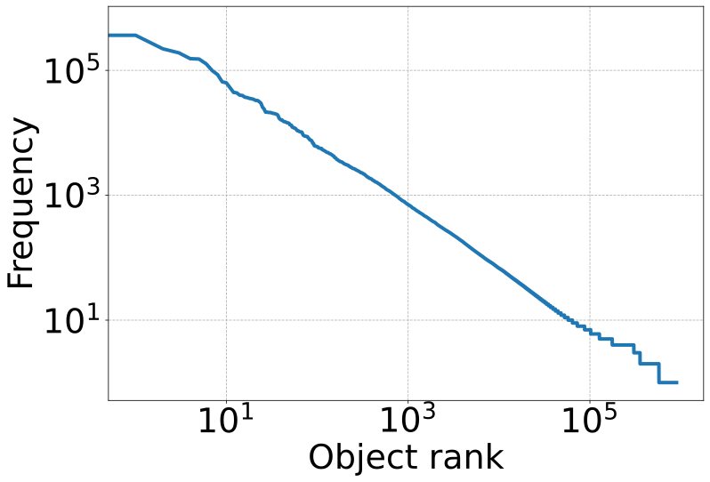
</p>
<p align="center"><i>Twitter cluster52, first 10M requests.</i></p>

Popularity is not meaningful on very small traces or on many block workloads. It also depends heavily on which layer of a cache hierarchy the trace was collected at.

### Size and reuse over time (heatmaps)

These plots cost more CPU and memory to produce.

The **size heatmap** needs timestamps and object sizes. The x-axis is time, the y-axis is object size, and darker cells mean more requests of that size at that time.

```bash
python3 ../scripts/traceAnalysis/size_heatmap.py ${dataname}.sizeWindow_w300
```

<p align="center">
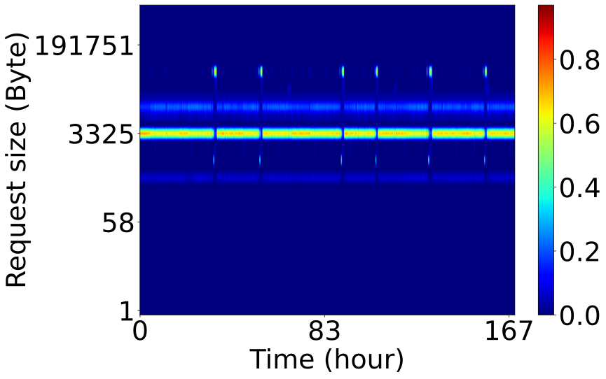
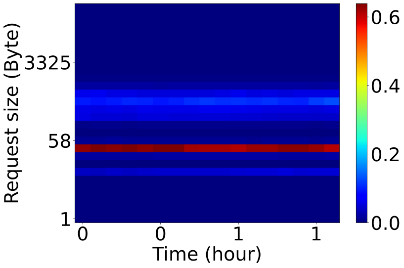
</p>
<p align="center"><i>Left: w92. Right: Twitter cluster52. Both are weighted by request; the script also writes versions weighted by object.</i></p>

The **reuse heatmap** puts time on the x-axis and reuse time (or reuse distance) on the y-axis.

```bash
python3 ../scripts/traceAnalysis/reuse_heatmap.py ${dataname}.reuseWindow_w300
```

<p align="center">
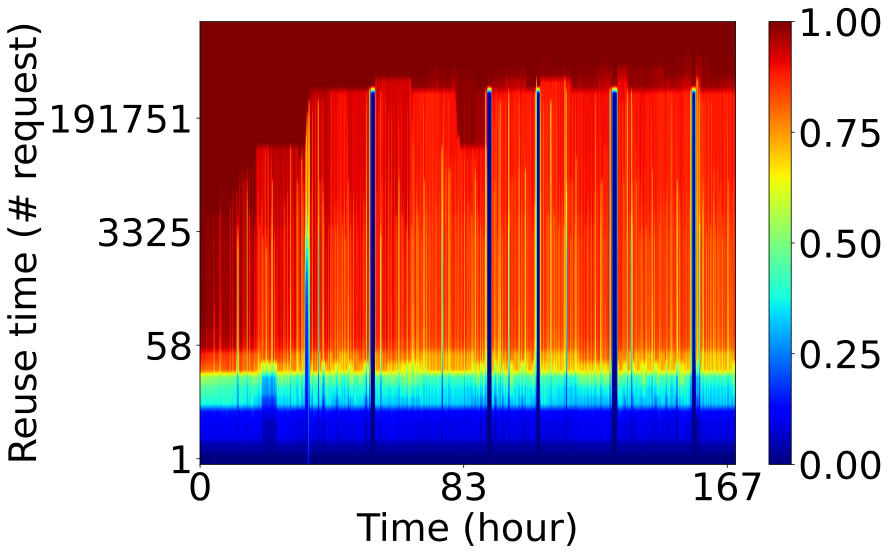
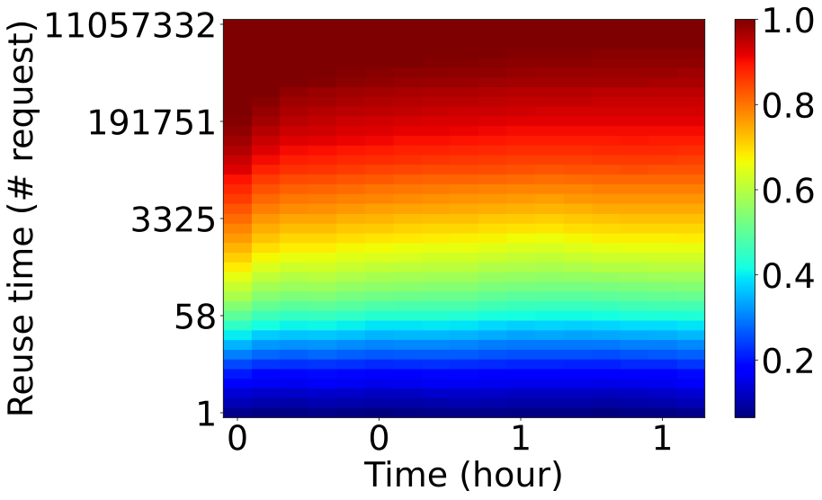
</p>
<p align="center"><i>Left: w92. Right: Twitter cluster52.</i></p>

Pass these two scripts the base name, without the `_req`/`_obj` or `_rt`/`_vt` suffix. Each script reads both files and makes both plots.

### Popularity decay

This shows how likely an object is to be requested again as it gets older. You need a long trace, around a week, for a useful plot. Most block workloads do not have enough requests.

```bash
./bin/traceAnalyzer <trace_path> <trace_type> --popularityDecay
python3 ../scripts/traceAnalysis/popularity_decay.py ${dataname}.popularityDecay_w300_obj
```

<p align="center">
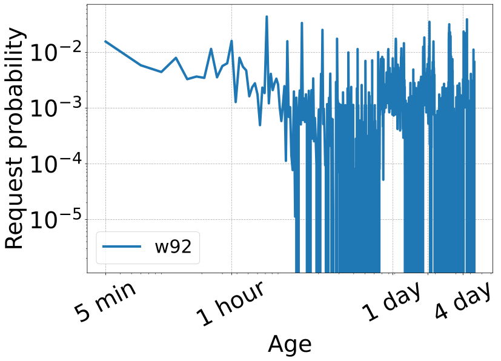
</p>
<p align="center"><i>w92: the average chance an object is requested, against its age. Both axes are log scale, with age from 5 minutes to 4 days. The downward slope is the decay.</i></p>

## Other useful options

```bash
# analyze only the first 1M requests
./bin/traceAnalyzer ../data/cloudPhysicsIO.vscsi vscsi --common --num-req=1000000

# name the output files my-output.size, my-output.reuse, ...
./bin/traceAnalyzer ../data/cloudPhysicsIO.vscsi vscsi --common -o my-output

# change the per-window analyses to 60-second windows
./bin/traceAnalyzer ../data/cloudPhysicsIO.vscsi vscsi --common --time-window=60
```

`--warmup-sec` tells the popularity decay analysis to skip the start of the trace. It defaults to 86400 (one day). The sample `cloudPhysicsIO` trace is only 7200 seconds (two hours) long, so with the default there is nothing left to analyze. On short traces, pass a smaller value such as `--warmup-sec=600`.

For csv traces, pass the same `-t` column options as `cachesim`, and add `obj-id-is-num=true` if the id column holds numbers. See [the cachesim guide](quickstart_cachesim.md) for the csv options.
